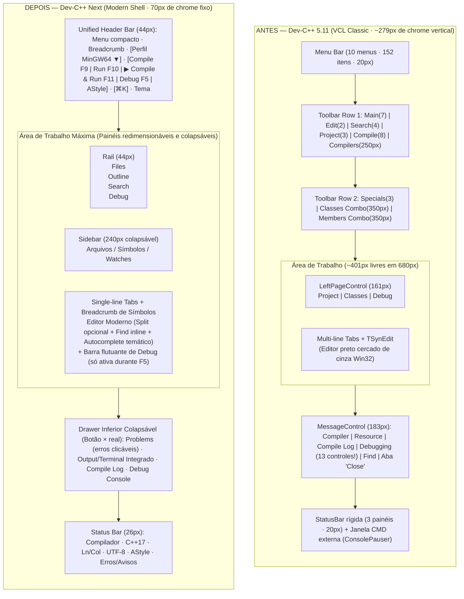
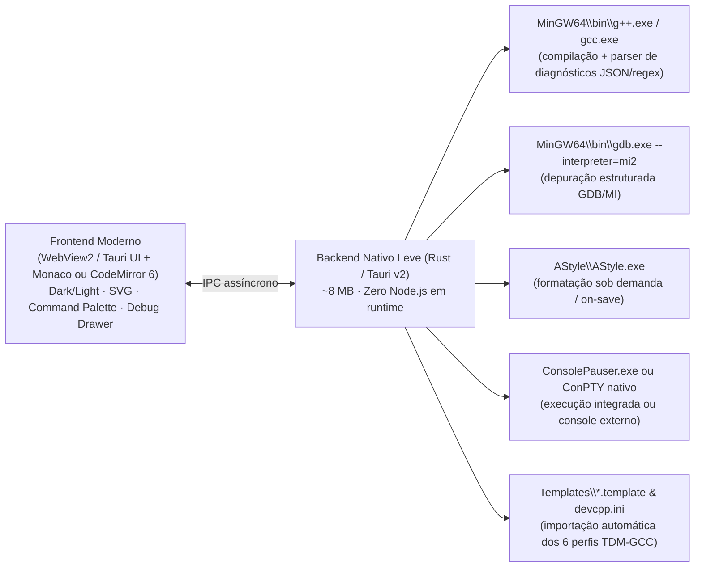

# Engenharia Reversa e Proposta de Reformulação Moderna da UI — Dev-C++ 5.11

> **Escopo e Integridade:** Toda a análise da Fase 1 foi realizada em modo **estritamente somente leitura** sobre os artefatos locais instalados em `C:\Program Files (x86)\Dev-Cpp` e `%APPDATA%\Dev-Cpp\devcpp.ini`, utilizando ferramentas estáticas do servidor MCP **REA (Reverse Engineer Anything)** e decodificação estrutural de recursos VCL/DFM (`TPF0`) e mapa de símbolos (`devcpp.map`). Nenhum arquivo em `Program Files` foi modificado.

---

## Sumário Executivo

O **Orwell Dev-C++ 5.11** (27/04/2015) continua popular no ensino e desenvolvimento rápido em C/C++ por sua leveza (`2,67 MiB`, inicialização instantânea e toolchain MinGW64 embutido). Contudo, a engenharia reversa do binário revela que sua interface ainda carrega restrições estruturais da arquitetura **Delphi 7 / VCL 32-bit ANSI (era Windows 98/XP)**:

- **Monólito de UI:** `TMainForm` concentra **499 componentes VCL**, **292 métodos** (`83,7 KB` de código x86 em `main.pas`), **10 menus** (`152` itens), **144 `TAction`s** e **8 barras de ferramentas** simultâneas em 2 linhas (`27` botões + `3` comboboxes).
- **Falha crítica de DPI / Manifesto:** Além de omitir `<dpiAwareness>` e `<compatibility>` do Windows 10/11, o recurso `RT_MANIFEST` embutido no PE foi compilado com o **nome literal `"CREATEPROCESS_MANIFEST_RESOURCE_ID"`** em vez do ID inteiro `#1` — um bug clássico de `.rc` sem `#include <winuser.h>`, mantendo o texto placeholder `"CompanyName.ProductName.YourApplication"`.
- **Tema escuro apenas parcial (contraste agressivo):** O `devcpp.ini` do usuário já tenta usar um editor escuro (`Space=clWhite, clBlack`), mas toda a moldura VCL (`TMainForm.Color=clBtnFace`, `TPageControl`, `TTreeView`, `TListView`, `CodeCompletion.BackColor=clWindow`) permanece presa ao cinza/branco Win32 clássico, sem qualquer importação de `dwmapi.dll` ou suporte a `DarkMode_Explorer`.
- **Inconsistência visual sistêmica:** Entre os **38 formulários DFM** embutidos, **23 (60,5%) são caixas fixas não redimensionáveis (`bsDialog`)**, misturando **4 fontes de design diferentes** (`Segoe UI`, `MS Sans Serif`, `Tahoma` e `Courier New`), com ícones raster fixos de **16×16 px** (e `11×14 px` no gutter).

A proposta **Dev-C++ Next** preserva a simplicidade e os atalhos consagrados (`F9`/`F10`/`F11`/`F12`) enquanto reduz o ruído de chrome de ~279 px para uma barra unificada de **44 px**, introduz tema **Dark/Light real**, paleta de comandos (`Ctrl+K`), depuração contextual, console integrado e acesso imediato ao **AStyle** e aos **15 templates** locais.

---

## Fase 1 — Engenharia Reversa Baseada em Evidências

### 1.1 Identidade dos Artefatos e Registro de Evidências (REA MCP)

| Artefato | Caminho Local | Tamanho | SHA-256 / Metadados | Evidência REA |
|---|---|---:|---|---|
| **Executável principal** | `C:\Program Files (x86)\Dev-Cpp\devcpp.exe` | 2.795.008 B | `5e490f306cace14810c9fdabf7e30a2c2e1941bedd5e00c54b24e208926527e1` (PE32 x86, entropia `6.5723` — não empacotado) | `ev_9f94336d…` (hardening), `ev_491fdd11…` (entropy) |
| **Recursos PE** | `devcpp.exe` (`.rsrc`) | 179 recursos | 40 `RT_RCDATA` (38 DFMs `TPF0`), 12 `RT_GROUP_ICON`, 34 `RT_ICON`, 28 `RT_BITMAP`, 47 `RT_STRING`, 1 `RT_MANIFEST`, 1 `RT_VERSION`, 1 `LNG` (`ENGLISH`) | `ev_12d41276790a020964953dcbce26c00018a640bd7dca2e6a7cae34bb3308bc79` |
| **Importações PE** | `devcpp.exe` (IAT) | 23 descritores / 571 funcs | Imphash `108241936cabba65f22353591bba6549`; 0 delay-imports; APIs 100% Win32 ANSI (`*A`) | `ev_a12c85f5c8c945febfa32172fe7fb5c9895d9c6da229513ea9806ae294f5d951` |
| **Exportações / Certificados** | `devcpp.exe` | 0 exports / 0 certs | Sem diretório de exportação; sem assinatura Authenticode (`IMAGE_DIRECTORY_ENTRY_SECURITY` ausente) | `ev_9949418f…`, `ev_bd05884f…` |
| **Console wrapper** | `C:\Program Files (x86)\Dev-Cpp\ConsolePauser.exe` | 171.008 B | PE32 x86; importa apenas `KERNEL32.dll` (62) + `msvcrt.dll` (54) | `ev_333cae1dd8ac96eae1b4c68f9ec3fc4d755e515352c466ac7d5e282f99dd5197` |
| **Mapa de símbolos** | `C:\Program Files (x86)\Dev-Cpp\devcpp.map` | 1.579.852 B | 177 units `.text` (`1.492.600 B`), 381 classes `T*` públicas | Leitura direta |
| **Manifesto externo** | `C:\Program Files (x86)\Dev-Cpp\devcpp.exe.manifest` | 695 B | SHA-256 `793e2d56…` (idêntico byte-a-byte ao `RT_MANIFEST` interno) | Leitura direta |
| **Configuração do usuário** | `C:\Users\vineee\AppData\Roaming\Dev-Cpp\devcpp.ini` | 329 linhas | 6 compiler sets TDM-GCC 4.9.2, tema `Blue`, editor preto/verde | Leitura direta |
| **Toolchain local** | `MinGW64\bin` & `AStyle\` | — | `g++ (tdm64-1) 4.9.2`, `GNU gdb 7.8.1`, `Artistic Style 2.03`, 15 `.template` | Verificação local |

---

### 1.2 Diagnóstico do Binário PE, Hardening, APIs Win32 e Manifesto/DPI

#### a) Perfil PE e Hardening (`inspect_binary_hardening` — `ev_9f94336d…`)
- **Arquitetura:** PE32 x86 (32-bit, `Machine = 0x014C`), `FileVersion = 5.11.0.0`, `CompanyName = Bloodshed Software` (`RT_VERSION`).
- **Entropia (`ev_491fdd11…`):** `6.5723` global (683 blocos de 4 KiB) — código nativo Delphi sem packer (UPX/ASPack).
- **Mitigações modernas desabilitadas:** `dynamic_base` (ASLR) = `disabled`, `nx_compat` (DEP) = `disabled`, `guard_cf` (CFG) = `disabled`, `force_integrity` = `disabled`, `authenticode_present` = `disabled`.
- **Load Config (`inspect_pe_load_config`):** Inexistente / RVA não mapeado em arquivo (típico de linker Borland/Delphi 7).

#### b) Importações Win32 (`inspect_pe_imports` — `ev_a12c85f5…`)
As **571 funções importadas** pertencem exclusivamente a DLLs clássicas Win32:
`user32.dll` (211), `kernel32.dll` (166), `gdi32.dll` (94), `comctl32.dll` (24 — `InitCommonControls` e `ImageList_*`), `wsock32.dll` (19 — Winsock 1.1), `shell32.dll` (13), `advapi32.dll` (12), `oleaut32.dll` (11), `imm32.dll` (5), `ole32.dll` (4), `comdlg32.dll` (4), `winspool.drv` (4), `version.dll` (3), `shfolder.dll` (1).

**Fatos críticos observados na tabela de importações:**
1. **Zero APIs de DPI moderno:** Ausência completa de `shcore.dll`, `SetProcessDPIAware`, `SetProcessDpiAwarenessContext` ou `GetDpiForWindow`.
2. **Zero APIs de composição moderna / Dark Mode:** Ausência de `dwmapi.dll` (impossibilita barra de título escura via `DwmSetWindowAttribute`), `d2d1.dll` e `dwrite.dll` (toda a renderização de texto do editor SynEdit usa **GDI clássico** `gdi32.dll`, sem DirectWrite).
3. **Aplicação ANSI pré-Unicode:** Praticamente todas as chamadas de UI e sistema de arquivos são versões `*A` (`CreateFontIndirectA`, `CreateFileA`, `ShellExecuteA`, `SHBrowseForFolderA`). Apenas `CommandLineToArgvW` é wide. Isso explica problemas históricos com caminhos contendo acentos/UTF-8.

#### c) Análise do Manifesto (`devcpp.exe.manifest` e `RT_MANIFEST`)
A inspeção combinada de `inspect_pe_resources` (`off=0x194114`, `695 B`) e do arquivo externo `devcpp.exe.manifest` revelou **três descobertas relevantes**:
1. **Bug de recurso interno:** O manifesto embutido foi nomeado com a string literal `"CREATEPROCESS_MANIFEST_RESOURCE_ID"` em vez do inteiro `1` (`RT_MANIFEST` ID `1`). Como o Windows procura ID `#1`, o recurso interno é ignorado e o aplicativo depende do sidecar externo `devcpp.exe.manifest`.
2. **Metadados de template não editados:** Contém literalmente `name="CompanyName.ProductName.YourApplication"` e `<description>Your application description here.</description>`.
3. **Ausência de DPI Awareness e Compatibility:** Declara apenas `Microsoft.Windows.Common-Controls 6.0.0.0` (Visual Styles do XP). Sem `<dpiAwareness>PerMonitorV2</dpiAwareness>`, em monitores 125%/150%/200% (Full HD notebooks, 2K, 4K), o Windows aplica **escalonamento por bitmap (GDI virtualization)**, deixando fontes do editor e ícones borrados.

---

### 1.3 Arquitetura Interna pelo Mapa de Símbolos (`devcpp.map`)

O mapa de símbolos revela **177 units** no segmento `.text` totalizando **1.492.600 bytes** de código compilado:

| Camada | Units | Código (bytes) | % do Binário | Componentes Principais |
|---|---:|---:|---:|---|
| **VCL / RTL / FastMM4** | 71 | 752.804 B | 50,4% | `ComCtrls`, `Controls`, `Forms`, `StdCtrls`, `Graphics`, `Menus`, `FastMM4` |
| **Dev-C++ Core & UI** | 78 | 541.517 B | 36,3% | `main` (83,7 KB), `Project` (34 KB), `devCFG` (34 KB), `CppParser` (30,4 KB), `EditorOptFrm` (25,1 KB), `ProjectOptionsFrm` (21,1 KB), `Compiler` (20,8 KB), `Editor` (19,4 KB) |
| **SynEdit (Editor)** | 28 | 198.279 B | 13,3% | `TCustomSynEdit` (281 métodos), `TSynCppSyn` (121 métodos), `SynTextDrawer`, `SynEditTextBuffer` |

**Classes-chave da UI e acoplamento (`devcpp.map` — 381 classes `T*`):**
- `TMainForm` (`main.pas`): **292 métodos** — atua como controlador monolítico para menus, toolbars, abas, árvore de projeto, compilação, depuração, busca, atalhos e temas (`LoadTheme`, `BuildBookMarkMenus`, `SetHints`...).
- `TEditor` (53 métodos) + `TEditorList` (24 métodos): encapsulam instâncias do `TSynEdit` em duas `TPageControl`s (`EditorPageControlLeft` e `EditorPageControlRight`, permitindo split horizontal de 2 editores).
- `TCppParser` (74 métodos) + `TClassBrowser` (21) + `TCodeCompletion` (13) + `TCodeToolTip` (14): parser C/C++ artesanal (pré-C++14/17/20), responsável pela aba `Classes` e pelos combos `cmbClasses`/`cmbMembers`.
- `TCompiler` (34 métodos), `TDebugger` (17) + `TDebugReader` (25): integração com `gcc/g++/mingw32-make` e `gdb` via pipes/anotações CLI (não usa GDB/MI moderno).
- `TDevImageTheme` (6) + `TDevImageThemeFactory` (5) + `TdmMain` (17): o conceito de **"Tema"** no Dev-C++ (`Theme="Blue"`) troca apenas **conjuntos de ícones `TImageList` 16×16** (`NewLook`, `Gnome`, `Blue`), **não** estiliza janelas ou controles VCL!

---

### 1.4 Mapeamento Completo da UI Atual (DFMs Decodificados)

A decodificação binária (`TPF0`) de todos os **38 formulários VCL** em `RT_RCDATA` mapeia a interface exata:

#### a) Janela Principal (`TMAINFORM` — `999×680`, `Font: MS Sans Serif`, `Color: clBtnFace`, 499 componentes)
1. **Barra de Menus (`TMainMenu` — 10 menus, 152 `TMenuItem`, 42 separadores):**
   - `File` (26), `Edit` (23), `Search` (9), `View` (16), `Project` (4), `Execute` (15), `Tools` (6), `AStyle` (2 — menu inteiro dedicado só a 2 ações!), `Window` (5), `Help` (4).
   - **7 menus de contexto (`TPopupMenu`)**, sendo `EditorPopup` sobrecarregado com **31 itens**.
   - **144 `TAction`s**, das quais **63** possuem atalhos padrão (ex.: `F9` Compile, `F10` Run, `F11` Compile & Run, `F12` Rebuild, `F5` Debug, `F4` Breakpoint, `F6` Stop, `F7` Next Line, `F8` Step Into, `Ctrl+R` Replace, `Ctrl+H` Project Options, `Ctrl+Shift+A` Format File).
2. **Dock de Barras de Ferramentas (`ToolbarDock: TControlBar`, `56px` de altura em 2 linhas):**
   - **8 `TToolBar`s** ativas por padrão no `devcpp.ini` do usuário (`27 botões 23×22px` + `3 comboboxes` largos):
     - **Linha 1 (`Y=2`):** `tbMain` (7 botões: New, Open, Save, Save All, Close, Close All, Print), `tbEdit` (2: Undo, Redo), `tbSearch` (4: Find, Replace, Goto Function, Goto Line), `tbProject` (3: Add, Remove, Options), `tbCompile` (8: Compile, Run, Compile & Run, Rebuild, Debug, Stop, Profile, Delete Profile), `tbCompilers` (`cmbCompilers` 250px).
     - **Linha 2 (`Y=30`):** `tbSpecials` (3: Insert, Toggle Bookmark, Goto Bookmark), `tbClasses` (`cmbClasses` 350px + `cmbMembers` 350px).
3. **Painel Esquerdo (`LeftPageControl: TPageControl`, padrão `193px`, `161px` no `devcpp.ini`):**
   - `Project` (`ProjectView: TTreeView`) — arquivos do projeto.
   - `Classes` (`ClassBrowser: TClassBrowser`) — árvore de símbolos/classes.
   - `Debug` (`DebugView: TTreeView`) — watches/variáveis (separado dos controles de execução do depurador!).
4. **Área Central do Editor (`PageControlPanel` → `EditorPageControlLeft` + `EditorPageControlRight`):**
   - `MultiLine=true` (abas empilham em múltiplas linhas, roubando altura do código).
   - Editor `TSynEdit` + highlighters `TSynCppSyn` e `TSynRCSyn` (`TDMMAIN`).
   - Imagens em `TDMMAIN`: 3 temas de ícones (`Gnome`, `NewLook`, `Blue`), todos **16×16 px** raster (`MenuImages_*`, `ProjectImage_*`, `ClassImages`), e `GutterImages` **11×14 px**.
5. **Painel Inferior (`MessageControl: TPageControl`, `183px` de altura, 6 abas):**
   - `Compiler` (`TListView`: Line, Col, Unit, Message)
   - `Resource` (`TListView`: Line, Col, Unit, Message)
   - `Compile log` (`btnAbortCompilation`, `pbCompilation`, `chkShortenPaths`, `LogOutput: TMemo`)
   - `Debugging` — **13 controles comprimidos em 183px**: `DDebugBtn`, `StopExecBtn`, `NextLineBtn`, `StepOverBtn`, `IntoLineBtn`, `SkipFuncBtn`, `NextInsBtn`, `IntoInsBtn`, `AddWatchBtn`, `ViewCPUBtn`, `EvaluateInput` + `EvalOutput`, `edGdbCommand` + `DebugOutput`.
   - `Find results` (`TListView`: ícone, Line, Col, Unit, Message)
   - `Close` (`CloseSheet`) — uma **aba inteira vazia** usada apenas como botão para fechar o painel!
6. **Barra de Status (`TStatusBar`, `20px`):** Apenas 3 painéis rígidos (`480px`, `80px`, `80px`).

#### b) Auditoria dos 38 Diálogos e Formulários
- **Fragmentação de fontes:** `Segoe UI` (20 forms), `MS Sans Serif` (16 forms — incluindo `TMainForm`, `TFindForm`, `TNewClassForm`, `TIncrementalForm`, `TWindowListForm`), `Tahoma` (1: `TfrmShortcutsEditor`), `Courier New` (1: `TCodeComplForm`).
- **Caixas fixas (`bsDialog`):** **23 de 38 formulários (60,5%)** não podem ser redimensionados, incluindo os diálogos mais densos: `TProjectOptionsFrm` (8 abas, 112 componentes em `534×382`), `TEditorOptForm` (6 abas + sub-abas, 121 componentes em `484×492`), `TCompOptForm` (4 abas, 54 componentes em `484×512`), `TEnviroForm` (4 abas, 59 componentes em `484×462`) e `TFindForm` (`330×330` modal).

---

### 1.5 Análise do `devcpp.ini` Atual do Usuário

O arquivo `C:\Users\vineee\AppData\Roaming\Dev-Cpp\devcpp.ini` evidencia o perfil de uso real e as limitações práticas:
- **Toolchain configurado:** 6 perfis TDM-GCC 4.9.2 (`64-bit/32-bit` × `Release/Debug/Profiling`), `Current=0`, `LinkOpt=-static-libgcc`, `ConsolePause=1`.
- **Tentativa frustrada de Dark Mode:** O usuário configurou um esquema escuro de alto contraste no editor (`Space=clWhite, clBlack`, `Identifier=clLime`, `Reserved Word=clGreen`, `Comment=$00FF6633`, `Symbol=clRed`, `Number=clBlue` sobre fundo preto — azul puro `#0000FF` sobre `#000000` tem contraste WCAG de apenas **2.44:1**, dificultando leitura!). Além disso, `CodeCompletion.BackColor=-16777211` (`clWindow`) abre um popup **branco brilhante** sobre o editor preto.
- **Tipografia datada:** `Editor.Font` = `Courier New 10pt` (sem suporte a ligaduras, serifa fina mal legível em telas modernas sem DirectWrite).
- **AStyle já configurado:** `-A2 --indent=tab=4 --indent-classes --indent-switches --indent-namespaces --indent-preprocessor`, mas escondido em um menu de topo dedicado com apenas 2 itens.
- **Sobrecarga de barras:** Todas as 8 toolbars estão ligadas (`Toolbar*=1`), `ProjectWidth=161` (estreito demais para nomes de arquivos/classes) e `MultiLineTab=1`.

---

### 1.6 Matriz de Gargalos Reais de UI/UX Identificados

| # | Categoria | Evidência Concreta (Fase 1) | Impacto na Usabilidade / Produtividade |
|---|---|---|---|
| **G1** | **Excesso de Toolbars & Ruído Visual** | 8 toolbars, 27 botões 23×22px + 3 combos em 2 linhas (`56px`), 10 menus (152 itens), `EditorPopup` com 31 itens | Alta carga cognitiva; botões frequentes (Compile & Run) competem visualmente com ações raras (Print, Delete Profile, Bookmarks). |
| **G2** | **Tema Escuro Incompleto & Contraste Ruim** | `TMainForm=clBtnFace`, zero `dwmapi.dll`, `CodeCompletion=clWindow`, `Number=clBlue` sobre `clBlack` (2.44:1) | Fadiga visual severa ("flashbang" branco/cinza ao redor do código preto); números azuis quase ilegíveis no fundo preto. |
| **G3** | **High-DPI Quebrado & Ícones 16×16** | Manifesto sem `dpiAwareness` + bug `"CREATEPROCESS_MANIFEST_RESOURCE_ID"` + ícones raster 16×16 | Interface borrada em monitores 125%–200%; impossível escalar ícones sem pixelização. |
| **G4** | **Fluxo de Depuração Fragmentado** | `DebugView` na aba esquerda (`161px`) + 13 botões/memos espremidos na aba `Debugging` inferior (`183px`) | Iniciantes se perdem para colocar breakpoint (`F4`), acompanhar variáveis e dar step (`F7`/`F8`); tela poluída fora do modo debug. |
| **G5** | **Hierarquia de Painéis e Abas** | Aba `"Close"` falsa no `MessageControl`; `MultiLineTab=1`; `ProjectWidth=161px`; Console externo via `ConsolePauser.exe` | Quebra de foco a cada execução (janela CMD externa); desperdício vertical em telas 16:9; fechamento contra-intuitivo do painel inferior. |
| **G6** | **Configurações em Diálogos Fixos (`bsDialog`)** | 23/38 formulários não redimensionáveis (`TEditorOptForm` 121 controles em `484×492`); busca em modal `TFindForm` (`330×330`) | Busca modal bloqueia visão do código; 4 diálogos de opções separados (`Environment`, `Editor`, `Compiler`, `Project`) sem pesquisa de configurações. |
| **G7** | **Atalhos Legados Conflitantes** | `Ctrl+H` = Project Options (em vez de Replace), `Ctrl+R` = Replace, `Ctrl+D` = Delete Line, `Ctrl+Q` = Swap Header | Fricção para quem alterna entre Dev-C++, VS Code, CLion ou navegadores. |

---

### 1.7 Limitações da Análise Estática (Transparência)

Para rigor metodológico (conforme diretrizes REA), registram-se explicitamente as seguintes limitações:
1. **Ausência de motor nativo de descompilação:** A consulta `binary_session` confirmou que nenhum backend de análise profunda está configurado neste host: **Ghidra** (`not_configured` — `GHIDRA_INSTALL_DIR` ausente), **IDA** (`not_configured` — `REA_IDA_MCP_CONFIG` ausente), **Kuna** (`not_configured` — `REA_KUNA_COMMAND` ausente) e **Hopper** (`unsupported_host` em `win32`).
2. **Escopo estático (sem observação em tempo de execução):** O binário `devcpp.exe` não foi executado nem instrumentado via Frida/debugger. Comportamentos dinâmicos de pintura customizada (`OnDrawItem`, `OnCustomDraw` em `TMainForm` ou `TClassBrowser`) e carregamento dinâmico via `LoadLibrary`/`GetProcAddress` (como chamadas internas de `UxTheme.pas`) são inferidos a partir da presença de units no `devcpp.map` e dos DFMs, não observados em runtime.
3. **Resolução de recursos:** A decodificação estrutural dos 38 DFMs (`TPF0`) e do `devcpp.map` cobriu 100% da hierarquia estática de formulários, menus, toolbars, actions e símbolos públicos, sendo totalmente suficiente para fundamentar o diagnóstico de UI/UX e o redesign.

---

## Fase 2 — Proposta de Reformulação Moderna da UI ("Dev-C++ Next")

### 2.1 Princípios de Design

1. **Leveza em primeiro lugar:** Manter o DNA do Dev-C++ — abrir um `.cpp` solto (sem precisar criar projeto) e pressionar `F11` deve continuar funcionando em menos de 1 segundo.
2. **Hierarquia orientada ao fluxo C/C++:** Promover **Compilar & Executar (`F11`)**, seleção do **Perfil do Compilador** e **Depurar (`F5`)** a elementos de primeira classe, escondendo controles de debug quando não há sessão ativa.
3. **Superfície limpa, zero redundância:** Substituir 8 toolbars + 10 menus extensos por uma **Header Bar unificada de 44 px**, um **Activity Rail de 44 px**, **Command Palette (`Ctrl+K`)** e **Find/Replace inline**.
4. **Legibilidade e acessibilidade (WCAG AA/AAA):** Tema Dark e Light reais de ponta a ponta (título, menus, árvores, editor, autocomplete, console) com contraste mínimo `≥ 7:1` para código e tipografia monoespaçada moderna.

---

### 2.2 Arquitetura de Layout: Antes (5.11) vs. Depois (Redesign)

**Ganho mensurável de espaço e clareza:**
- **Toolbars:** de **8 barras / 27 botões / 2 linhas (`56px`)** → **1 barra unificada (`44px`)** com 5 ações primárias claras + Command Palette.
- **Aba "Close" falsa:** eliminada → botão `×` real + atalho ``Ctrl+` `` para recolher/expandir o drawer inferior.
- **Combos `cmbClasses`/`cmbMembers` (700px de largura!):** substituídos por **Breadcrumbs discretos no topo do editor** (`main.cpp › VectorUtils › sortAndFilter()`) + painel Outline na sidebar.
- **Find/Replace:** migrado de modal bloqueante (`TFindForm 330×330`) para **barra inline flutuante** no canto superior direito do editor.

---

### 2.3 Sistema de Design (Design System)

#### a) Paletas de Cores (Dark "Obsidian Slate" & Light "Daylight Paper")

| Token Semântico | Dark Mode (Padrão) | Light Mode | Uso |
|---|---|---|---|
| `--bg-canvas` | `#0F1117` | `#FFFFFF` | Fundo do editor de código |
| `--bg-surface` | `#161922` | `#F6F8FA` | Header, sidebar, drawer inferior |
| `--bg-elevated` | `#1E2230` | `#FFFFFF` | Modais, Command Palette, Autocomplete |
| `--border-subtle` | `#262B3D` | `#E1E5EE` | Divisores de 1px sem bordas 3D |
| `--text-primary` | `#E6EDF3` | `#1F2328` | Texto principal e identificadores (contraste > 12:1) |
| `--text-secondary` | `#8B949E` | `#57606A` | Labels secundários, breadcrumbs, números de linha |
| `--accent-primary` | `#3B82F6` (hover `#60A5FA`) | `#2563EB` | Ação primária (`Compile & Run`), foco, aba ativa |
| `--status-success` | `#22C55E` | `#16A34A` | Build bem-sucedido, botão Run |
| `--status-warning` | `#F59E0B` | `#D97706` | Warnings do GCC, modo Debug ativo |
| `--status-error` | `#EF4444` | `#DC2626` | Erros de compilação, breakpoints |

#### b) Syntax Highlighting C/C++ (Contraste WCAG AAA)
- **Keywords (`int`, `class`, `return`, `const`):** `#C084FC` (Dark) / `#7C3AED` (Light)
- **Types / STL (`std`, `vector`, `string`, `size_t`):** `#38BDF8` (Dark) / `#0284C7` (Light)
- **Functions (`main`, `printf`, `push_back`):** `#60A5FA` (Dark) / `#1D4ED8` (Light)
- **Strings & Chars:** `#4ADE80` (Dark) / `#15803D` (Light)
- **Numbers / Constants:** `#FB923C` (Dark) / `#C2410C` (Light) — *corrige o azul ilegível sobre preto do `devcpp.ini`!*
- **Preprocessor (`#include`, `#define`):** `#F472B6` (Dark) / `#BE185D` (Light)
- **Comments:** `#6E7681` itálico (Dark) / `#6B7280` itálico (Light)

#### c) Tipografia, Ícones e Espaçamento
- **UI Font:** `Segoe UI Variable`, `Inter`, `Segoe UI`, sans-serif (`13px` corpo, `12px` labels/tabs, `11px` status bar).
- **Code Font:** `JetBrains Mono`, `Cascadia Code`, `Consolas`, monospace (`14px`, `line-height: 1.6`, suporte opcional a ligaduras `->`, `!=`, `<=`, `::`).
- **Ícones:** Vetoriais **SVG stroke 1.75px** (estilo Lucide) em `16×16` (inline/árvore) e `18×18` (rail/header) — nitidez perfeita em 100%–300% DPI.
- **Grid de Espaçamento:** Escala base de **4px** (`4`, `8`, `12`, `16`, `24`), cantos arredondados suaves (`6px` controles, `10px` modais/popups).

---

### 2.4 Reorganização das Ações Principais e Atalhos Rápidos

| Fluxo | Como funciona no Dev-C++ Next | Atalho (Híbrido Dev-C++ / Moderno) |
|---|---|---|
| **Compilar / Executar** | Cluster unificado na Header Bar com **Compile & Run** em destaque + seletor de perfil TDM-GCC ao lado | `F9` Compile · `F10` Run · `F11` Compile & Run · `F12` Rebuild |
| **Depuração (GDB)** | Modo contextual: ao clicar em `Debug (F5)`, surge uma **barra flutuante** no editor (`Continue`, `Step Over`, `Step Into`, `Stop`) e a sidebar abre automaticamente **Variables / Watch / Call Stack / Breakpoints**. Breakpoints clicáveis direto na calha (gutter). | `F5` Debug · `F4` Breakpoint · `F7` Step Over · `F8` Step Into · `F6` Stop |
| **Formatar (AStyle)** | Botão direto na Header Bar + ação na Command Palette + opção "Format on Save", reutilizando `AStyle.exe` e os presets (`-A1`, `-A2`, `-A3`). | `Ctrl+Shift+A` (preservado do 5.11) / `Shift+Alt+F` |
| **Templates de Projeto** | Modal visual moderno lendo os **15 `.template`** reais da pasta `Templates\` com filtro por categoria (`Basic`, `GUI`, `Concurrency`, `Graphics`), preview instantâneo do código-fonte e criação em 1 clique. | `Ctrl+Shift+N` Novo Projeto / Template |
| **Navegação & Busca** | **Command Palette** unifica todas as 144 ações antigas; **Find/Replace inline** no editor; **Find in Files** na sidebar. | `Ctrl+K` / `Ctrl+Shift+P` Comandos · `Ctrl+F` Find · `Ctrl+H` Replace (ou `Ctrl+R` no modo Clássico) · `Ctrl+G` Go to Line |

> **Modo de Atalhos Selecionável:** Nas configurações, o usuário pode alternar entre **Dev-C++ Híbrido (Recomendado)** — mantém `F9`/`F10`/`F11`/`F12`/`F5` e adota `Ctrl+H` para Replace e `Ctrl+K` para Command Palette — e **Dev-C++ 5.11 Clássico** (`Ctrl+R` Replace, `Ctrl+H` Project Options).

---

## Fase 3 — Caminhos de Implementação e Protótipo

### 3.1 O que pode ser feito no Dev-C++ 5.11 atual vs. Reconstrução da UI

| Melhoria | Trilha A: Patch no Dev-C++ 5.11 Atual (sem recompilar) | Trilha B: Novo Frontend Moderno + Toolchain Local |
|---|---|---|
| **Esquema de cores legível no editor** | **Sim (imediato):** atualizar `[Editor.Syntax]` e `[Editor.Font]` (`Cascadia Code`/`Consolas 11pt`) no `devcpp.ini` (arquivo pronto salvo em `quickwin-devcpp-modern-dark.ini`). | **Sim (nativo):** temas Dark/Light completos com troca instantânea. |
| **Dark Mode real (menus, abas, árvores, barra de título, autocomplete)** | **Não:** VCL Delphi 7 não possui VCL Styles nem `dwmapi.dll`/`DarkMode_Explorer`; `TMainForm` continua cinza `clBtnFace`. | **Sim (100%):** CSS/WinUI dark nativo + barra de título escura no Windows 10/11. |
| **High-DPI nítido (125%–200%)** | **Parcial com ressalvas:** adicionar `<dpiAwareness>PerMonitorV2</dpiAwareness>` no `devcpp.exe.manifest` melhora a nitidez do texto, **mas** ícones `16×16` ficam minúsculos e diálogos `bsDialog` cortam controles por coordenadas fixas. | **Sim (100%):** layout responsivo + SVG vetorial perfeito em qualquer escala. |
| **Reduzir 8 toolbars / nova organização de painéis / Find inline / Command Palette** | **Muito limitado:** é possível apenas ocultar 4–5 toolbars no `devcpp.ini` (`ToolbarEdit=0`, `ToolbarSpecials=0`, etc.), mas não unificar header nem eliminar a aba `"Close"`. | **Sim (100%):** arquitetura moderna completa. |
| **Console integrado + erros clicáveis modernos** | **Não:** limitado ao `TListView` e `ConsolePauser.exe` externo. | **Sim:** terminal PTY embutido (com opção de usar `ConsolePauser.exe` externo). |
| **Reuso do MinGW64, GDB, AStyle e Templates locais** | Já integrado (porém limitado ao parser C++ antigo e GDB texto puro). | **100% reaproveitável:** invoca diretamente `MinGW64\bin\g++.exe`, `gdb.exe --interpreter=mi2`, `AStyle\AStyle.exe`, `ConsolePauser.exe` e lê `Templates\*.template` e `devcpp.ini`! |

### 3.2 Arquitetura Recomendada para Implementação Completa (Trilha B)

Para entregar a nova interface mantendo a leveza histórica do Dev-C++ (instalador pequeno, baixo uso de RAM e startup sub-segundo):

- **Por que Tauri v2 (Rust + WebView2 nativo do Windows 10/11)?**
  - Binário final de ~6–10 MB (vs. ~120 MB do Electron), consumo de RAM muito menor e inicialização rápida.
  - Reaproveita diretamente o protótipo HTML/CSS/JS validado na Fase 3, evoluindo o editor para **CodeMirror 6** ou **Monaco** + integração opcional com `clangd` no futuro (mantendo o `MinGW64` local intacto).
  - Usa **ConPTY** do Windows para terminal integrado (eliminando janelas CMD soltas) e **GDB/MI2** para depuração limpa sem parsing frágil de texto.

### 3.3 Arquivos Entregues em `C:\Users\vineee\Documents\REA`

1. **`relatorio-engenharia-reversa-redesign.md`** — Este relatório completo com evidências REA, diagnóstico e especificação de redesign.
2. **`devcpp-modern-prototype.html`** — Protótipo interativo completo (arquivo único, sem dependências externas, basta abrir no navegador) para validar visualmente e testar todos os fluxos:
   - Alternância **Dark / Light** em tempo real;
   - Comparador visual **Antes (5.11) vs. Depois (Next)**;
   - Edição multi-aba com **Split View**, destaque de sintaxe C++, **Autocomplete temático**, **Find & Replace inline** e **Formatação AStyle funcional**;
   - Simulação interativa de **Compilar (`F9`)**, **Compilar & Executar (`F11`)** com erros clicáveis + **Console Integrado**, e **Depuração passo a passo (`F5` / `F7` / `F8`)** com breakpoints na calha, call stack e variáveis vivas;
   - **Command Palette (`Ctrl+K`)**, **Modal de Templates reais** da instalação local e **Configurações** (tipografia, AStyle, keymap Clássico vs. Híbrido).
3. **`quickwin-devcpp-modern-dark.ini`** — Pacote pronto de melhoria imediata (Trilha A) com paleta dark acessível (WCAG AA/AAA) e limpeza de toolbars para quem quiser aplicar manualmente no `devcpp.ini` atual.

---

## Adendo — Adaptação C-First (Baseada no Roteiro Cronológico de C · 2º Semestre)

Após a análise do roteiro local (`plano_de_aula_em_c_roteiro_cronol_gico_pc_papel.html`), o protótipo [devcpp-modern-prototype.html](file:///C:/Users/vineee/Documents/REA/devcpp-modern-prototype.html) foi refinado especificamente para **Linguagem C (`gcc.exe -std=c11 -Wall -Wextra`)** e para o fluxo de estudo/ensino **PC + Papel**:

1. **Defaults C-First (corrigindo `DefCpp=1` do `devcpp.ini`):**
   - Compilador padrão alterado para `gcc.exe` (`C11 64-bit -Wall`, `C11 Debug -g`, `C99 Estrito`), arquivos `.c`/`.h`, destaque especial para operadores de ponteiro (`->`), e **AStyle** padrão C (`-A3` K&R).
   - **6 templates C-first** (Console C, Struct + Ponteiro `a->campo`, Matriz 2D, Busca Binária + Swap, `malloc`/`free`, Módulo `.h`).
2. **Alinhamento direto aos 6 Blocos + Desafio Integrado do Roteiro:**
   - Painel lateral de **Roteiro C (2h30)** com os 7 arquivos prontos para executar (`01_funcoes.c`, `02_matrizes.c`, `03_struct.c`, `04_ponteiros.c`, `05_ordenacao.c`, `06_busca_binaria.c` e `07_desafio_integrado.c`), exibindo o lembrete do fechamento **no papel** de cada bloco.
3. **Visualizador de Memória & Ponteiros (SVG) + Teste de Mesa Automático (`F5`):**
   - Ao depurar `04_ponteiros.c` (`F5` → `F7`), a barra lateral desenha ao vivo as **caixinhas de endereço (`0x100`, `int x`, `int *p = &x`, seta `*p`, `aux` no `troca` e `a->nota`)**, espelhando exatamente o diagrama do Bloco 4.
   - Ao depurar `06_busca_binaria.c`, exibe visualmente o vetor com os ponteiros `ini`, `meio` e `fim` descartando metades a cada iteração.
   - A aba **Teste de Mesa (Trace)** no drawer inferior monta automaticamente a tabela passo a passo (`Passo | Linha | Função | Variáveis | O que aconteceu`) para conectar a execução no PC ao treino no papel.
4. **Diagnósticos GCC Amigáveis para Erros Clássicos de Prova:**
   - O botão **`⚡ Simular Erro C`** demonstra o tradutor pedagógico sobre erros reais do `gcc.exe` (como esquecer o `;` após `typedef struct { ... } Aluno;` ou chamar `troca(x, y)` sem `&`), mostrando a causa em português e correção em 1 clique.
